# 👨‍💻 Philipp Magalhães

 

---

## 🚀 Sobre mim

Sou estudante de Análise e Desenvolvimento de Sistemas,
com interesse em desenvolvimento backend, banco de dados
e soluções tecnológicas para problemas reais.

- 🎓 Estudante de ADS
- 💻 Aprendendo C#, .NET, Java e SQL
- 🔧 Desenvolvendo aplicações e protótipos
- 🎯 Foco em oportunidades na área de tecnologia

---

## ⚡ Tecnologias e Ferramentas

---

## 📊 GitHub Analytics

---

## 🧩 Projetos em Destaque

### 📋 Sistema de Controle de Chamados
Sistema para gerenciamento e acompanhamento de
solicitações e chamados.

### 🏢 Aplicativo de Gestão Condominial
Aplicativo para consulta de documentos, balancetes
e informações condominiais.

### 🏭 Monitoramento Industrial
Protótipo de monitoramento industrial com ESP32
e simulador desenvolvido em C#.

---

## 👾 Pac-Man | Minhas Contribuições

<picture>
  <source
    media="(prefers-color-scheme: dark)"
    srcset="https://raw.githubusercontent.com/philipp211196/philipp211196/output/pacman-contribution-graph-dark.svg"
  />
  <source
    media="(prefers-color-scheme: light)"
    srcset="https://raw.githubusercontent.com/philipp211196/philipp211196/output/pacman-contribution-graph.svg"
  />
  
</picture>

---

## 📫 Contato

📧 **E-mail:** Filipe2111@hotmail.com

💼 **GitHub:** [philipp211196](https://github.com/philipp211196)

---

### 💡 Sempre aprendendo, evoluindo e construindo.

